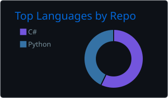
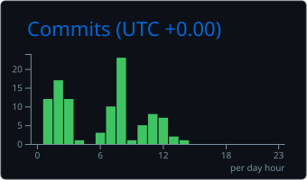
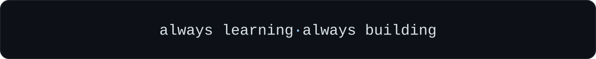

<!-- Header: animated banner with the walking snow bear. Swaps to a tall layout on phones. -->
<picture>
  <source media="(max-width: 700px)" srcset="assets/header-mobile.svg" />
  
</picture>

  
  

### `// about`

<picture>
  <source media="(max-width: 700px)" srcset="assets/terminal-mobile.svg" />
  
</picture>

### `// tech stack`

  <picture>
    <source media="(max-width: 700px)" srcset="https://skillicons.dev/icons?i=py,cs,dotnet,js,html,css,nodejs,mysql,postgres,git,github,vscode&theme=dark&perline=6" />
    
  </picture>

### `// my journey, wrapped`

  

### `// activity`

<!-- Appears after .github/workflows/snake.yml has run once from the Actions tab -->
<picture>
  <source media="(prefers-color-scheme: dark)" srcset="https://raw.githubusercontent.com/KentSimon07/KentSimon07/output/contribution-snake-dark.svg" />
  
</picture>

### `// how I code`

<!-- Appears after .github/workflows/stats.yml has run once from the Actions tab -->

  
  

### `// connect`

  
  
  

<picture>
  <source media="(max-width: 700px)" srcset="assets/footer-mobile.svg" />
  
</picture>
